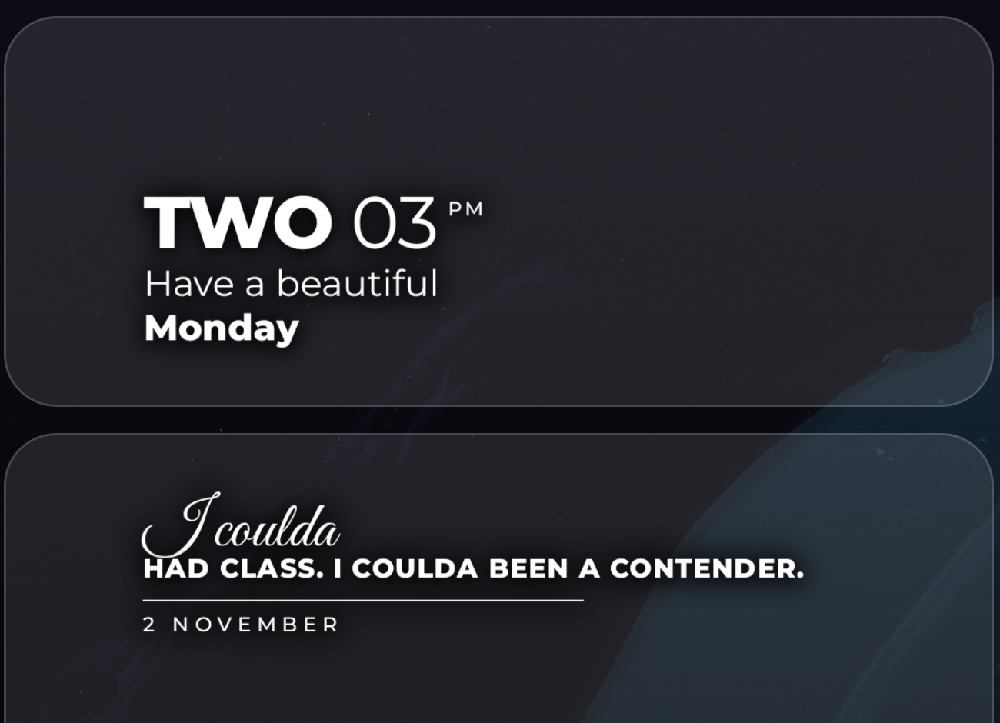
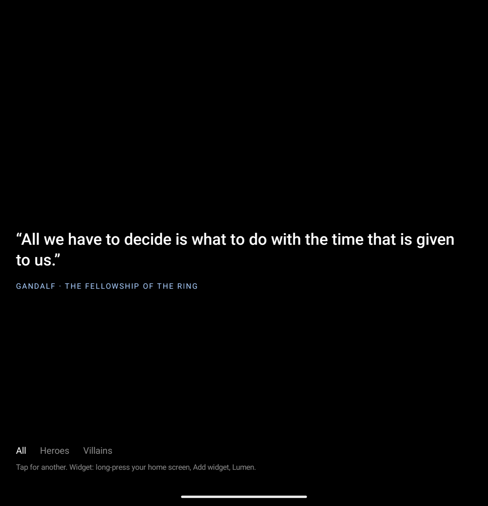
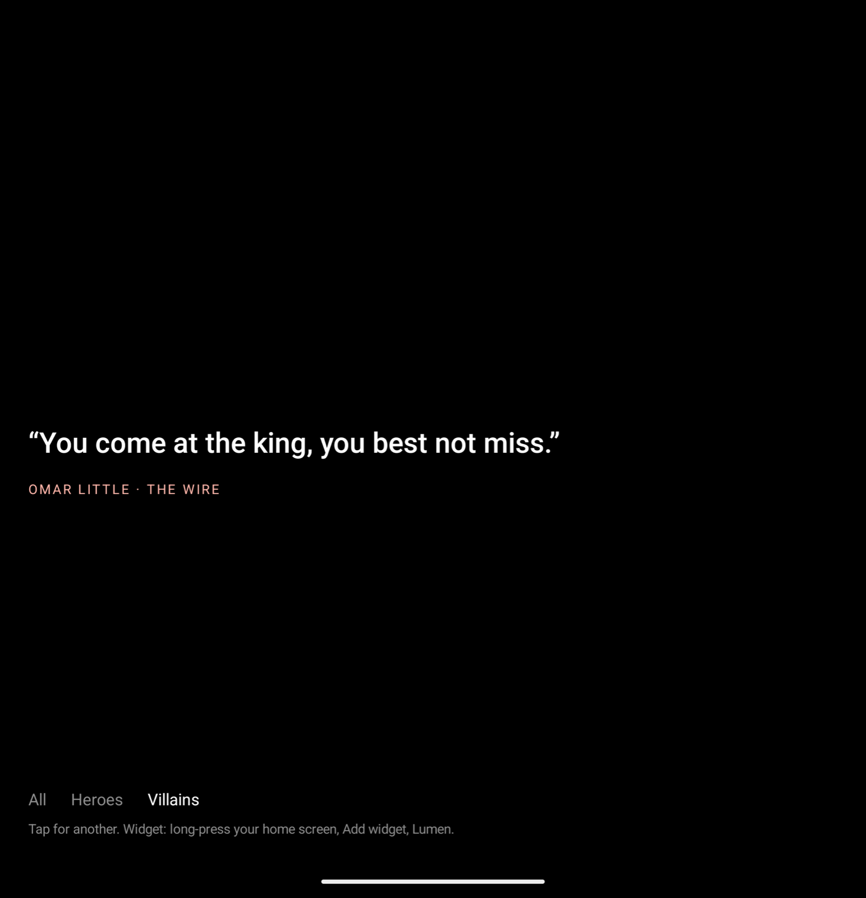

# Lumen

Hero and villain lines from films and TV, set like a magazine cover on your Android home screen, with a
word-clock widget to match. Everything is drawn on the phone; Lumen has no network permission.



## Why

Lock-screen quote apps tend to come in two kinds: plain text in a box, or a feed you have to scroll.
Desaturate-style lock screens look great but are static images. Lumen is the small thing in between: one good
line at a time, set in a handwritten script and heavy caps, that turns over on its own and reads on any wallpaper.

## What it does

- **294 lines from 137 films and shows.** 197 heroes and 97 villains: Bane, Tywin Lannister, Omar Little,
  Gandalf, Terry Malloy, Thomas Shelby. Filter to all, heroes or villains in the app.
- **Shuffle-bag rotation.** Every line shows once per round before any repeats, never the same twice in a row.
  The quote widget turns over every 30 minutes (Android's floor) or on tap.
- **Magazine typesetting.** The first word in Great Vibes script, the rest in Montserrat Heavy caps, a hairline,
  then the date in spaced small caps. Rendered to a bitmap sized exactly to the widget slot, so it is never scaled.
- **Readable on any wallpaper.** White text over a soft dark cloud: the same text thickened and blurred, which
  hugs the words where a rectangle read as a grey box.
- **A word clock.** "TWO 03 PM / Have a beautiful Monday": the hour as a heavy word, the minutes thin. It
  redraws on the minute with a non-waking alarm, so it is right the moment you look and never wakes the phone.
- **Short slots get short lines.** A one-row slot only shows lines of 90 characters or fewer, so nothing has to
  shrink or end mid-sentence on a lock screen.

## Screenshots

| | |
|---|---|
|  |  |
| Widgets | App |
|  | |
| Villains | |

*Screenshots come from a stock Pixel 9 Pro Fold emulator via `Tools/screenshots.sh`; the wallpaper is the
emulator's default.*

## Quick start

Requirements: JDK 21, the Android SDK (compileSdk 37), a phone on Android 12 or later with USB debugging on.

```bash
git clone https://github.com/aaryann123/lumen && cd lumen
echo "sdk.dir=$ANDROID_HOME" > local.properties
npm run dev        # ./gradlew :app:installRelease
```

Long-press your home screen, **Widgets**, **Lumen**, and add **Lumen** and **Lumen Clock**. The clock also
declares the lock-screen category, for launchers and lock screens that take widgets. Open the Lumen app to read lines full screen; tap for the
next one, and pick All, Heroes or Villains at the bottom. No cable: `npm run apk` writes `Lumen.apk`.

## Requirements

| | |
|---|---|
| Phone | Android 12+ (minSdk 31), tested on a Galaxy Z Fold 7 and the Pixel Fold emulator |
| Build | JDK 21, Android Gradle Plugin 9.4, Jetpack Compose for the app screen |
| Permission | `USE_EXACT_ALARM`, for the minute tick |
| Signing | The release build uses the debug key, so it installs without a keystore |
| Lock screen | The clock is offered to lock screens that host widgets; the quote is a home-screen widget |

## How it's organised

```
app/src/main/java/app/lumen/
  Quotes.kt        the 294 lines, pool / deal / fitting
  QuoteWidget.kt   current quote state, the quote widget and its typesetting
  ClockWidget.kt   the word clock and its minute alarm
  Slot.kt          sizing art to a widget slot, the white ink and its dark cloud
  MainActivity.kt  the full-screen reader
docs/              ARCHITECTURE.md, BUILDING.md, quote candidates
Tools/             screenshot script
```

See [docs/ARCHITECTURE.md](docs/ARCHITECTURE.md) for how it works and [docs/BUILDING.md](docs/BUILDING.md) for
building and adding lines.

## Contributing

Pull requests are welcome.

- `npm test` runs the unit tests (filters, shuffle bag, short-slot fallback, clock words).
- Adding a line: one `h(...)` or `v(...)` row in `Quotes.kt`: the line, who says it, the film or show. Keep it short
  and well known; `docs/top-200-candidates.md` has a backlog.
- Screenshots come from the emulator script, never from a personal phone.
- Good first projects: a light-text-on-dark-wallpaper toggle, user-added quotes, per-widget filters.

## Credits and licence

Lumen is MIT licensed, see [LICENSE](LICENSE).

- [Montserrat](https://github.com/JulietaUla/Montserrat) by Julieta Ulanovsky and contributors, and
  [Great Vibes](https://github.com/googlefonts/great-vibes) by TypeSETit, both SIL Open Font License 1.1
  ([licenses/OFL.txt](licenses/OFL.txt)).
- The quotes are short lines from the films and series named beside each one, credited to their characters and
  works; all rights stay with their owners.
- The look follows the Desaturate lock-screen style; no assets from it are used.
